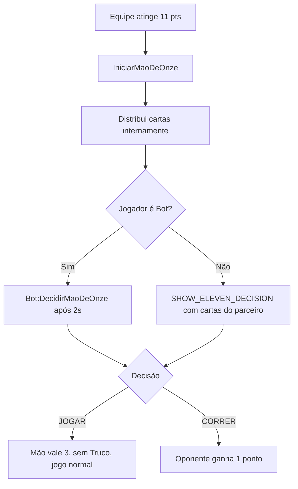

# UC-09 — Mão de Onze

**Ator Principal**: Servidor, Jogador (equipe com 11 pts), Bot  
**Pré-condições**: `Placar.TeamX == 11`, `Placar.TeamY < 11` ao chamar `VerificarProximaRodada()`  
**Regras de Negócio**: RN-28, RN-29, RN-31  

---

## Fluxo Principal

```
1. Servidor detecta uma equipe com 11 pontos em VerificarProximaRodada()
2. Chama RoundManager:IniciarMaoDeOnze(equipeOnze)
3. Servidor prepara baralho e distribui cartas internamente (sem UI de corte)
4. Estado muda para ELEVEN_DECISION
5. Para cada jogador da equipe com 11 pontos:
   a. Servidor busca as cartas do parceiro (MaosJogadores[parceiro])
   b. Se Bot: Bot:DecidirMaoDeOnze(maoParceiro) após 2s
   c. Se Humano: EventBroadcaster emite SHOW_ELEVEN_DECISION(maoParceiro)
6. Jogador (ou Bot) decide: "JOGAR" ou "CORRER"
7. GameStatusEvent("HandOfElevenDecision", decisao) → servidor
8. RoundManager:DecidirMaoDeOnze(jogador, decisao)
```

## Fluxo A: Equipe decide JOGAR

```
9. Estado muda para PLAYING
10. Mão inicia valendo 3 pontos (RN-29)
11. Truco desativado (RN-31)
12. Turnos normais começam via iniciarTurnosPosDistribuicao()
```

## Fluxo B: Equipe decide CORRER

```
9. FinalizarMao(equipeOponente, 1) — oponente ganha 1 ponto
10. Próxima rodada inicia
```

## Comportamento do Bot na Mão de Onze

```lua
-- Lógica atual (Bot.luau:DecidirMaoDeOnze)
-- Joga se tiver Manilha de força >= 3 (Copas ou Zap) em qualquer mão da dupla
-- Limitação: não avalia a mão inteira — ver Issue #1
```

---

## Diagrama de Decisão



---

## Implementação

- [`Match:VerificarProximaRodada()`](../../src/server/Classes/Match.luau#L222-L236)
- [`RoundManager:IniciarMaoDeOnze()`](../../src/server/Classes/RoundManager.luau#L303-L335)
- [`RoundManager:DecidirMaoDeOnze()`](../../src/server/Classes/RoundManager.luau#L342-L357)
- [`Bot:DecidirMaoDeOnze()`](../../src/server/Classes/Bot.luau#L71-L90)
