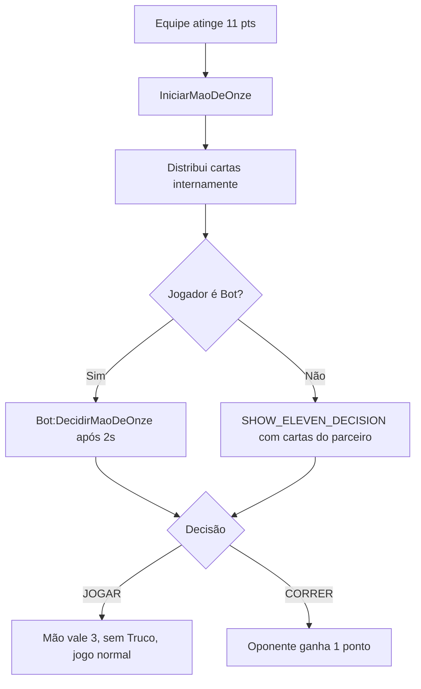

# UC-09 — Mão de Onze

**Ator Principal**: Servidor, Jogador (equipe com 11 pts), Bot  
**Pré-condições**: `Placar.TeamX == 11`, `Placar.TeamY < 11` ao chamar `VerificarProximaRodada()`  
**Regras de Negócio**: RN-28, RN-29, RN-31  

---

## Fluxo Principal

```
1. Servidor detecta uma equipe com 11 pontos em VerificarProximaRodada()
2. Chama RoundManager:IniciarMaoDeOnze(equipeOnze)
3. Servidor prepara baralho e distribui cartas internamente (sem UI de corte), definindo ValorRodada = 3 e TrucoAtivo = false
4. Estado muda para ELEVEN_DECISION
5. Para cada jogador da equipe com 11 pontos:
   a. Servidor busca as cartas do parceiro (MaosJogadores[parceiro])
   b. Se Bot: Bot:DecidirMaoDeOnze(maoParceiro) após 2s
   c. Se Humano: EventBroadcaster emite GameStatusEvent("SHOW_ELEVEN_DECISION", maoParceiro)
6. Jogador (ou Bot) decide: "JOGAR" ou "CORRER"
7. Cliente dispara GameStatusEvent("HandOfElevenDecision", decisao) → servidor
8. RoundManager:DecidirMaoDeOnze(jogador, decisao)
```

## Fluxo A: Equipe decide JOGAR

```
9. Chama iniciarTurnosPosDistribuicao(): notifica cartas, muda estado para PLAYING
10. Mão inicia valendo 3 pontos (RN-29) com Truco desativado (RN-31)
11. EventBroadcaster emite HIDE_ELEVEN_DECISION
```

## Fluxo B: Equipe decide CORRER

```
9. FinalizarMao(equipeOponente, 1) — oponente ganha 1 ponto
10. EventBroadcaster emite HIDE_ELEVEN_DECISION e inicia próxima rodada
```

## Comportamento do Bot na Mão de Onze

- `Bot:DecidirMaoDeOnze(maoParceiro)` combina `self.Mao` + `maoParceiro` e joga se encontrar qualquer carta com `ManilhaStrength >= BotConfig.Dificuldades[dificuldade].MinManilhaStrengthMaoDeOnze` (padrão `3`, Copas ou Zap).

## Diagrama de Decisão



> [!NOTE]
> **Fluxo Completo (`D-01` Corrigido)**: Para humanos na equipe com 11 pontos, o servidor envia primeiro `DealCards` (suas cartas + Vira) e `SHOW_ELEVEN_DECISION` (cartas do parceiro), exibindo o modal `PainelMaoDeOnze` em `UIManager.luau` com os botões `JOGAR (VALE 3)` e `CORRER (-1 PT)` e timeout de segurança de 20s no servidor. `DecidirMaoDeOnze` valida no servidor se o jogador pertence à `EquipeMaoDeOnze`.

---

## Implementação

- [`Match:VerificarProximaRodada()`](../../src/server/Classes/Match.luau#L231-L245)
- [`RoundManager:IniciarMaoDeOnze()`](../../src/server/Classes/RoundManager.luau#L325-L384)
- [`RoundManager:DecidirMaoDeOnze()`](../../src/server/Classes/RoundManager.luau#L391-L411)
- [`Bot:DecidirMaoDeOnze()`](../../src/server/Classes/Bot.luau#L84-L105)
- [`UIManager._CriarMenuMaoDeOnze()`](../../src/client/UI/UIManager.luau#L660-L843)
