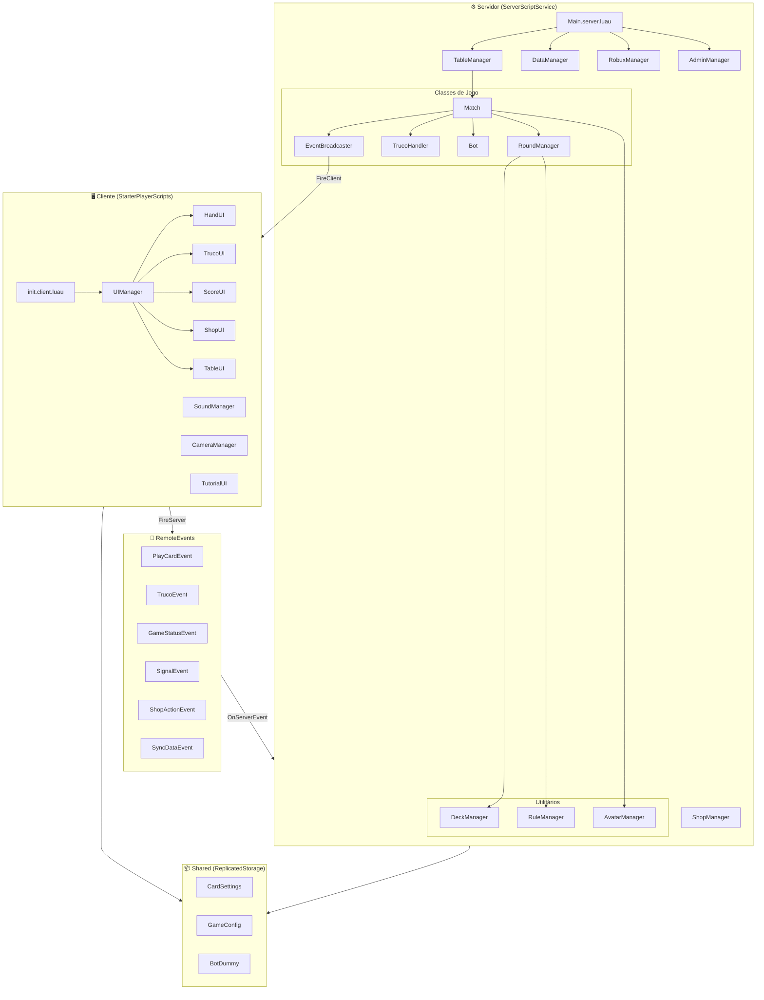
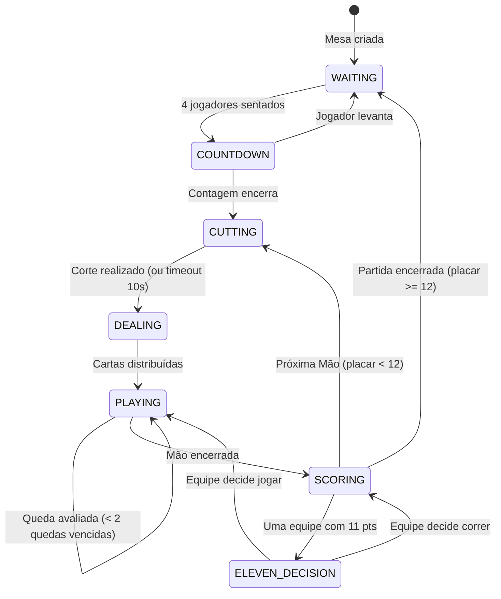

# 🏗️ Arquitetura do Sistema

## Visão Geral

O Truco Paulista segue o modelo **Client-Server obrigatório do Roblox**, onde o servidor é a única fonte de verdade (estado canônico). Clientes apenas exibem informações e enviam intenções ao servidor.

---

## Módulos e Responsabilidades

### Servidor

| Arquivo | Responsabilidade |
|---------|-----------------|
| `Main.server.luau` | Entry point: inicializa `TableManager`, `DataManager`, `ShopManager` |
| `TableManager.luau` | Cria instâncias de `Partida` para cada mesa 3D, mapeia jogador→mesa, roteia RemoteEvents |
| `DataManager.luau` | Persistência via DataStore: carrega/salva pontos, skins por `UserId` |
| `ShopManager.luau` | Processa compras e equipamentos de skins (via `ShopActionEvent`) |
| `RobuxManager.luau` | Processa compras com Robux via `MarketplaceService` |
| `AdminManager.luau` | Comandos de administrador |
| **`Match.luau`** | Orquestra uma partida completa: assentos, placar, estados, callbacks |
| **`RoundManager.luau`** | Gerencia cada Mão: baralho, distribuição, turnos, quedas, avaliação |
| **`TrucoHandler.luau`** | Gerencia o desafio de Truco: request, response, timeout, votos de dupla |
| **`Bot.luau`** | IA dos bots: jogar carta, decidir truco, decidir Mão de Onze |
| **`EventBroadcaster.luau`** | Centraliza emissão de RemoteEvents para jogadores humanos |
| `DeckManager.luau` | Cria baralho 40 cartas, embaralha, corta, define manilhas |
| `RuleManager.luau` | Calcula força de carta, determina vencedor de uma Queda |
| `AvatarManager.luau` | Busca avatares de amigos para aplicar skins nos bots |

### Cliente

| Arquivo | Responsabilidade |
|---------|-----------------|
| `init.client.luau` | Entry point do cliente: instancia e conecta todos os módulos de UI |
| `UIManager.luau` | Gerencia todas as UIs: qual mostrar, qual esconder por evento de estado |
| `HandUI.luau` | Renderiza as cartas na mão do jogador, clique para jogar |
| `TrucoUI.luau` | Botões e animações de Truco (pedir, aceitar, correr, aumentar) |
| `ScoreUI.luau` | Placar da partida e pontuação de quedas |
| `ShopUI.luau` | Loja de skins (aba Pontos e aba Robux) |
| `TableUI.luau` | Cartas na mesa, vira, animações de distribuição |
| `TableVisuals.luau` | SurfaceGUI das cartas 3D na mesa física |
| `SoundManager.luau` | Gerencia sons e trilha sonora |
| `CameraManager.luau` | Posiciona câmera ao sentar/levantar da mesa |
| `TutorialUI.luau` | UI do tutorial para novos jogadores |

### Shared (ReplicatedStorage)

| Arquivo | Responsabilidade |
|---------|-----------------|
| `CardSettings.luau` | Naipes, valores, mapeamento spritesheet, registro de Skins |
| `GameConfig.luau` | Constantes globais: `MAX_PLAYERS`, tempos, estados, times |
| `BotDummy.rbxm` | Template 3D do avatar do bot |

---

## Fluxo de uma Partida

---

## Protocolo de Rede (RemoteEvents)

### Cliente → Servidor

| Evento | Payload | Descrição |
|--------|---------|-----------|
| `PlayCardEvent` | `(cardId: string, escondida: boolean)` | Jogar carta |
| `TrucoEvent` | `(acao: "Request"\|"Response", subAcao?: string)` | Ação de Truco |
| `GameStatusEvent` | `(acao: "CutAction"\|"HandOfElevenDecision", valor)` | Corte ou decisão de Mão de Onze |
| `SignalEvent` | `(tipoSinal: string)` | Emote/sinal visual |
| `ShopActionEvent` | `(acao: "Comprar"\|"Equipar", skinId: string)` | Ação na loja |

### Servidor → Cliente (via EventBroadcaster)

| Evento | Descrição |
|--------|-----------|
| `SHOW_SCOREBOARD` | Exibir placar ao sentar |
| `UPDATE_SCORE` | Atualizar placar |
| `WAITING` / `COUNTDOWN` / `CUTTING` / `DEALING` | Mudança de estado |
| `DISTRIBUTE_CARDS` | Receber cartas na mão |
| `CARD_PLAYED` | Carta jogada na mesa |
| `CLEAR_TABLE` | Limpar cartas da mesa após queda |
| `TRUCO_CALLED` | Truco foi pedido |
| `TRUCO_ACEITO` / `TRUCO_FUGIU` | Resposta ao Truco |
| `SHOW_ELEVEN_DECISION` | Mostrar decisão da Mão de Onze |
| `MATCH_WON` | Fim de partida |
| `UPDATE_STATUS` | Mensagem de status na tela |
