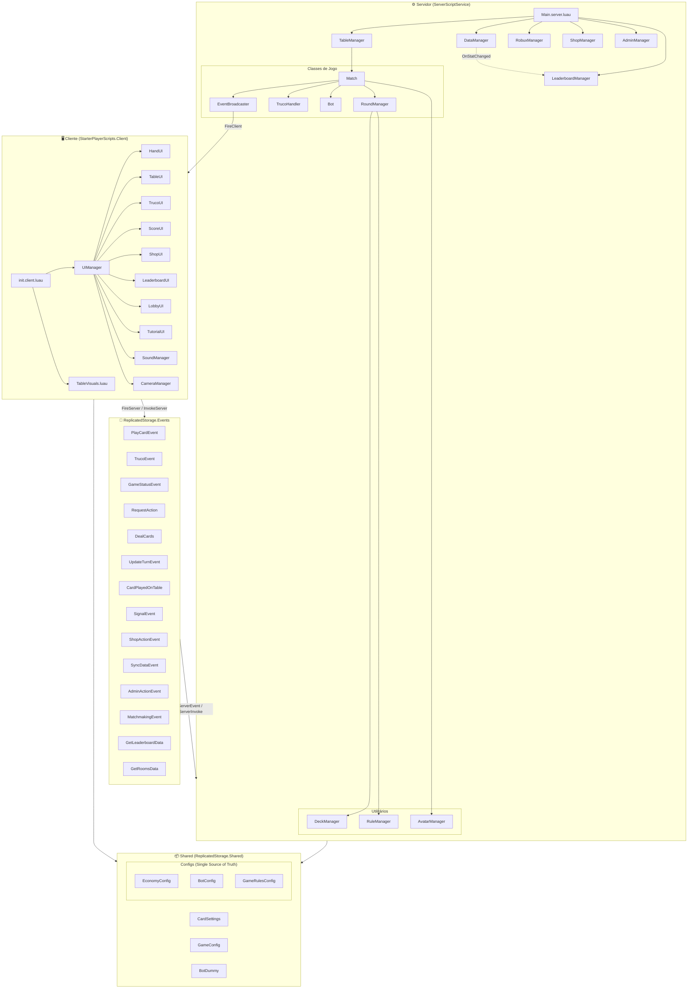
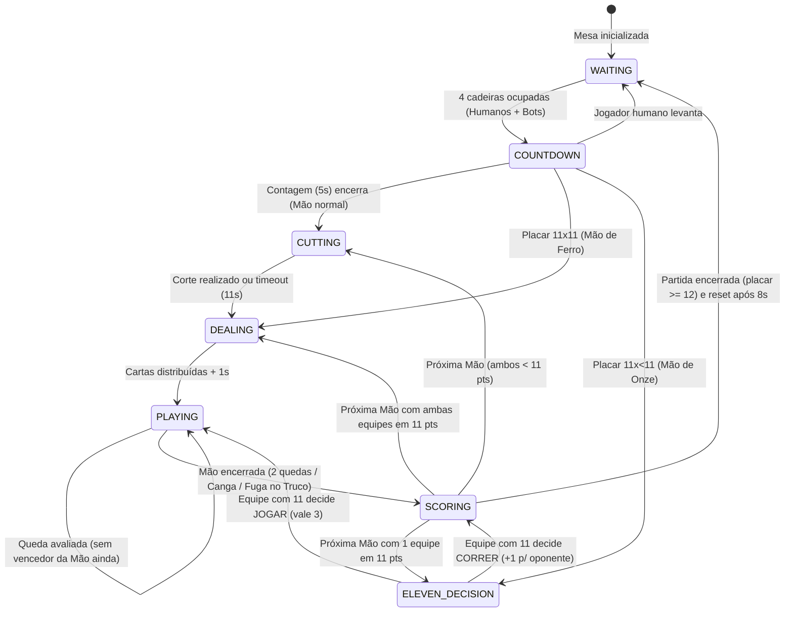

# 🏗️ Arquitetura do Sistema

## Visão Geral

O Truco Paulista segue o modelo **Client-Server autoritativo do Roblox**, onde o servidor é a única fonte de verdade (estado canônico). Clientes apenas exibem informações (2D ScreenGui + 3D SurfaceGui na mesa) e enviam intenções ao servidor. Todo o código-fonte é versionado externamente via **Rojo** (`default.project.json`).



---

## Módulos e Responsabilidades

### Servidor (`src/server/`)

| Arquivo | Responsabilidade |
|---------|-----------------|
| `Main.server.luau` | Entry point: carrega serviços globais (`DataManager`, `ShopManager`, `RobuxManager`, `AdminManager`, `LeaderboardManager`) e inicializa `TableManager` com `Workspace.MesasFolder` |
| `TableManager.luau` | Cria instâncias de `Partida` (`Match`) para cada modelo de mesa, resolve assentos de Bots por `Attribute` (`TipoMesa`) ou prefixo do nome via `CONFIG_BOTS`, mapeia `jogadorParaMesa` e roteia eventos de rede |
| `DataManager.luau` | Persistência no DataStore `TrucoData_v1`: carrega/salva `Pontos`, `Vitorias`, `Derrotas`, `PartidasJogadas`, `RobuxGasto`, `SkinsCompradas` e `SkinEquipada`; cria `leaderstats` e notifica `OnStatChanged` |
| `LeaderboardManager.luau` | Gerencia 3 `OrderedDataStore` (`Leaderboard_Vitorias_v1`, `Leaderboard_Pontos_v1`, `Leaderboard_Robux_v1`), atende `GetLeaderboardData` e renderiza o Top 10 em `Workspace.LeaderboardBoard` |
| `ShopManager.luau` | Processa `ShopActionEvent` (`"Comprar"` e `"Equipar"`), validando preços diretamente de `EconomyConfig.PrecosSkins` |
| `RobuxManager.luau` | Processa compras de Robux via `MarketplaceService.ProcessReceipt` consultando `EconomyConfig.ProdutosPontosMap` e `DoacoesMap` |
| `AdminManager.luau` | Processa `AdminActionEvent` validando o `UserId` do administrador no servidor |
| `Classes/Match.luau` | Orquestra uma partida completa: assentos, bots visuais (`BotDummy`), placar, contagem, estados e recompensas pós-partida |
| `Classes/RoundManager.luau` | Gerencia cada Mão: corte, baralho, `ViraAtual`, distribuição, turnos, quedas, Mão de Onze e Mão de Ferro |
| `Classes/TrucoHandler.luau` | Gerencia o desafio de Truco: request, response, timeout (`15s`) e votação de dupla humana |
| `Classes/Bot.luau` | IA dos bots parametrizada por `BotConfig`: corte, jogada de turno, resposta a Truco e decisão de Mão de Onze |
| `Classes/EventBroadcaster.luau` | Centraliza emissão de RemoteEvents do servidor para jogadores humanos |
| `Utils/DeckManager.luau` | Cria baralho limpo de 40 cartas, embaralha (`Random.new()`), corta e define manilhas |
| `Utils/RuleManager.luau` | Calcula força de carta (`CalcularForcaCarta`) e determina vencedor da Queda (`ObterVencedorRodada`) |
| `Utils/AvatarManager.luau` | Busca avatares de amigos via `Players:GetFriendsAsync()` com cache de 5 minutos para vestir os Bots |

### Cliente (`src/client/`)

| Arquivo | Responsabilidade |
|---------|-----------------|
| `init.client.luau` | Entry point do cliente: inicializa `UIManager`, monitora assento do jogador (`TableVisuals`), escuta RemoteEvents, controla BGM em loop e verifica proximidade da `ZonaTutorial` |
| `TableVisuals.luau` | Instancia cartas físicas 3D com `SurfaceGui` na pasta `CartasNaMesa` da mesa atual e anima o arremesso até o topo da mesa |
| `UI/UIManager.luau` | Orquestrador da `ScreenGui` (`TrucoGui`): barra de menu lateral, menu de corte, opções Aberta/Coberta, botão `TRUCO!`, emotes, painel admin (`F4`), notificações e sinais `BillboardGui` |
| `UI/HandUI.luau` | Renderiza as cartas na mão do jogador local com hover e seleção de jogada |
| `UI/TableUI.luau` | Grade 2D central (`UIGridLayout`) exibindo as cartas jogadas na queda atual |
| `UI/TrucoUI.luau` | Pop-up de desafio de Truco (`DESCER`, `FUGIR`, `AUMENTAR`) com barra de tempo e integração com `CameraManager` |
| `UI/ScoreUI.luau` | HUD de cronômetro/status, placar (`JOGO: X x Y`), valor da mão (`VALE: N`), estatísticas de quedas e display da Vira |
| `UI/ShopUI.luau` | Modal de Loja com abas **PONTOS** (skins via `EconomyConfig.Skins`) e **ROBUX** (produtos via `EconomyConfig.ProdutosRobux`) |
| `UI/LeaderboardUI.luau` | Botão `🏆` na barra unificada e Modal de Ranking Global com abas (`Vitórias`, `Pontos`, `Apoiadores`) e card de desempenho próprio |
| `UI/LobbyUI.luau` | Barra de lobby com `"▶ JOGAR AGORA"` (Quick Play), `"🃏 SALAS"`, modal de Matchmaking/Salas Públicas e Privadas, toasts e badge de código privado |
| `UI/TutorialUI.luau` | Modal com carrossel de 6 slides explicando as regras do Truco Paulista |
| `UI/CameraManager.luau` | Aplica zoom cinematográfico (`Enum.CameraType.Scriptable`) no autor do pedido de Truco e restaura após decisão |
| `UI/SoundManager.luau` | Reproduz SFX pontuais (`Shuffle`, `Truco`, `CardPlay`, `Victory`) com suporte a toggle de mudo |

### Shared (`src/shared/`)

| Arquivo | Responsabilidade |
|---------|-----------------|
| `Configs/EconomyConfig.luau` | **Single Source of Truth**: recompensas PvP/PvE, catálogo de skins (`PrecosSkins`) e produtos Robux (`ProdutosPontosMap`, `DoacoesMap`, `ProdutosPrecoRobuxMap`) |
| `Configs/BotConfig.luau` | **Single Source of Truth**: tempos de pensamento/resposta e calibração de dificuldades (`Facil`, `Normal`, `Dificil`) |
| `Configs/GameRulesConfig.luau` | **Single Source of Truth**: `MAX_PLAYERS`, `PONTOS_VITORIA_PARTIDA`, tempos limite, valores de Mão, parâmetros de Mão de Onze/Ferro, `States`, `StateDisplayNames` e `TEAMS` |
| `CardSettings.luau` | Naipes, valores, coordenadas de spritesheet (`93x133`), registro de asset IDs das skins e `AplicarSkinCarta()` |
| `GameConfig.luau` | Módulo de retrocompatibilidade que reexporta constantes de `GameRulesConfig` |
| `BotDummy.rbxm` | Modelo R15 base clonado pelo servidor para representar bots sentados |

---

## Fluxo de Estados de uma Partida



---

## Protocolo de Rede (`ReplicatedStorage.Events`)

### Cliente → Servidor

| Evento / Função | Tipo | Payload | Handler Servidor |
|-----------------|------|---------|------------------|
| `PlayCardEvent` | `RemoteEvent` | `(cardId: string, escondida: boolean)` | `TableManager` → `Match:JogadorJogarCarta` |
| `TrucoEvent` | `RemoteEvent` | `(acao: "Request"\|"Response", subAcao?: "Aceitar"\|"Correr"\|"Aumentar")` | `TableManager` → `Match:ProcessarAcaoTruco` |
| `GameStatusEvent` | `RemoteEvent` | `(acao: "CutAction"\|"HandOfElevenDecision", valor: number\|string)` | `TableManager` → `Match` |
| `SignalEvent` | `RemoteEvent` | `(tipoSinal: "Sinal_Mao"\|"Sinal_Olhar")` | `TableManager` → `Match:TransmitirSinal` |
| `ShopActionEvent` | `RemoteEvent` | `(acao: "Comprar"\|"Equipar", skinId: string)` | `ShopManager` |
| `AdminActionEvent` | `RemoteEvent` | `(acao: "Adicionar"\|"Remover", alvoNome: string, quantidadeStr: string)` | `AdminManager` |
| `MatchmakingEvent` | `RemoteEvent` | `("QuickPlay"\|"EntrarMesa"\|"EntrarPorCodigo"\|"CriarSala", arg1?, arg2?)` | `TableManager` (UC-15) |
| `GetLeaderboardData` | `RemoteFunction` | `(categoria: "Vitorias"\|"Pontos"\|"Robux")` | `LeaderboardManager` |
| `GetRoomsData` | `RemoteFunction` | `()` → `SalaResumo[]` | `TableManager` (UC-15) |

### Servidor → Cliente

#### RemoteEvents Dedicados

| Evento | Payload | Descrição |
|--------|---------|-----------|
| `DealCards` | `(mao: Card[], vira: Card, nomeParceiro: string)` | Entrega as 3 cartas da mão do jogador e a Vira |
| `UpdateTurnEvent` | `(nomeVez: string, numRodada: number)` | Informa de quem é a vez e qual queda está ativa (1..3) |
| `CardPlayedOnTable` | `(nomeExibicao: string, valor: string, naipe: string, escondida: boolean, skin: string)` | Renderiza carta na UI 2D e na mesa 3D |
| `RequestAction` | `(tipo: "EscolhaOCorte"\|"TrucoChallenge", dados: any)` | Abre menu de corte (`10s`) ou modal de desafio de Truco |
| `SignalEvent` | `(remetente: Player, tipoSinal: string)` | Exibe `BillboardGui` e `Highlight` sobre o remetente |
| `SyncDataEvent` | `(dados: table)` | Atualiza pontos, vitórias e skins em `ShopUI` e `HandUI` |

#### Mensagens via `GameStatusEvent` (emitidas por `EventBroadcaster`)

| Mensagem | Payload (`dados`) | Descrição |
|----------|-------------------|-----------|
| `WAITING` / `COUNTDOWN` / `CUTTING` / `DEALING` | `0` ou segundos | Atualiza status/cronômetro na tela |
| `SHOW_SCOREBOARD` / `HIDE_SCOREBOARD` | `nil` / `0` | Exibe ou oculta placar ao sentar/resetar |
| `SHOW_GAME_UI` / `HIDE_GAME_UI` | `nil` / `0` | Mostra ou reseta toda a HUD da partida |
| `UPDATE_SCORE` | `{TeamA: number, TeamB: number}` | Atualiza placar da partida |
| `UPDATE_ROUND_VALUE` | `number` (`1\|3\|6\|9\|12`) | Atualiza indicador de quanto vale a mão atual |
| `CLEAR_TABLE` | `{TeamA: number, TeamB: number, Winner: string}` | Limpa mesa 2D/3D, atualiza placar de quedas e dispara SFX de vitória/derrota da queda |
| `TEAM_A_WON_HAND` / `TEAM_B_WON_HAND` / `DRAW_HAND` | `{Value, Names}` | Exibe resultado da Mão encerrada |
| `MATCH_WON` | `string` (ex: `"X e Y Venceram!"`) | Exibe overlay de vitória da partida |
| `TRUCO_CALLED` | `number` (`3\|6\|9\|12`) | Toca som de Truco e anuncia pedido |
| `TRUCO_ACEITO` / `TRUCO_FUGIU` / `TRUCO_TIMEOUT` | `number` / `string` / `0` | Resposta ou expiração do desafio |
| `PARTNER_VOTED` / `WAITING_PARTNER` | `string` / `0` | Feedback de votação em dupla humana |
| `SHOW_TRUCO_BTN` / `HIDE_TRUCO_BTN` | `nil` / `0` | Habilita ou oculta botão de Truco |
| `SHOW_ELEVEN_DECISION` / `HIDE_ELEVEN_DECISION` | `maoParceiro: Card[]` / `nil` | Envia cartas do parceiro na Mão de Onze *(handler pendente no cliente)* |
| `UPDATE_STATUS` | `string` | Mensagem genérica de status (ex: motivo de reset ou pontos ganhos) |

---

## Contrato do Mapa 3D (`Workspace`)

Os scripts do projeto dependem diretamente da seguinte estrutura no **Roblox Studio**:

```
Workspace
├── Cenário/                           (Praça Paulista: calçada de pedra portuguesa, decks, pergolados, luminárias, fontes, casario brasileiro e vegetação)
├── MesasFolder/
│   ├── Mesa1 .. Mesa6                 (6 Mesas PvP — 4 humanos; Attribute TipoMesa = "PvP"; feltro verde esmeralda)
│   ├── MesaPvE_Solo_1 .. MesaPvE_Solo_2   (Bots nas cadeiras 2, 3, 4; Attribute TipoMesa = "MesaPvE_Solo"; feltro azul)
│   ├── MesaPvE_Dupla_1 .. MesaPvE_Dupla_2 (Bots nas cadeiras 2, 4; Attribute TipoMesa = "MesaPvE_Dupla"; feltro azul)
│   └── MesaPvE_Trio_1 .. MesaPvE_Trio_2   (Bot na cadeira 4; Attribute TipoMesa = "MesaPvE_Trio"; feltro azul)
│       ├── Mesa/Topo                  (BasePart — referência de altura/centro 3D)
│       ├── Cadeiras/Cadeira1..4       (Cada uma contendo um Seat)
│       └── CartasNaMesa/              (Folder para Parts das cartas jogadas)
├── LeaderboardBoard                   (Part ou Model para SurfaceGui do Top 10)
├── PodioTop3/                         (Palco/Pódio 3D ao lado do LeaderboardBoard populado por LeaderboardManager)
│   ├── Pedestal1..3/                  (Contendo Base, Topo, PontoAvatar e Placa/PlacaPodioGui)
│   └── AvataresTop3/                  (Folder onde os avatares reais do Top 3 de Vitórias são instanciados)
└── Tutorial/
    ├── Barraquinha                    (Quiosque temático de praça)
    └── copinhodecocacola              (NPC guia com ProximityPrompt `PromptTutorial` para abrir TutorialUI)
```

---

## Ecossistema SDD: Skills Automatizadas e MCP

- **Skills (`.gemini/skills/` e espelho `skills/`)**:
  - `truco-core-rules`: Invariantes de força, manilhas, cartas cobertas e canga + `tests/test_rules.py`.
  - `truco-match-flow`: Máquina de estados, escalonamento `1->3->6->9->12` e anti-cheat + `tests/test_match_flow.py`.
  - `game-balance-economy`: Validação de `src/shared/Configs/` e compliance `RN-09` + `tests/validate_configs.py`.
- **Servidores MCP**:
  - `Roblox_Studio`: Inspeção e manipulação da hierarquia, propriedades, scripts e capturas de tela em tempo real no Studio.
  - `roblox-studio-logs` (`tools/mcp_roblox_logs/server.py`): Leitura de output, erros e warnings de execução do Roblox Studio.
